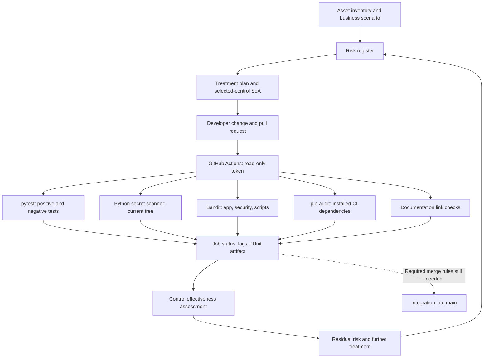

# ISO 27001 Secure CI/CD

A practical DevSecOps and GRC portfolio lab connecting **risk assessment → control
selection → technical implementation → automated testing → audit evidence → residual
risk evaluation**. The fictional NovaTech scenario uses Python and GitHub Actions
to demonstrate how security requirements become repeatable CI checks.

**This is a limited portfolio simulation, not ISO/IEC 27001 certification or a full
ISMS implementation.** Mappings show support for selected controls; they do not
establish compliance. See the [scope and assurance boundary](grc/scope.md).

## Business scenario and objectives

NovaTech develops a customer application. An accidentally committed API credential
could enable unauthorized access, customer-data exposure, or service abuse. The lab
starts with that risk and retains its original identifier, **RISK-001**, and control,
**CTRL-001 — Automated Secret Detection**.

The objectives are to detect selected insecure changes, reject incomplete security
checks, make results reviewable, and explain what risk remains. The repository also
assesses vulnerable development dependencies and the possibility of bypassing CI.
The original `app/app.py` is a runnable scanner demonstration, not a customer web
server. There is no production deployment or live customer data in this project.

## Technology stack

| Component | Purpose |
|---|---|
| Python 3.12 in CI; Python 3.12+ locally | Standard-library secret scanner and original app demo |
| Git and GitHub pull requests | Versioned changes and review records |
| GitHub Actions on Ubuntu 24.04 | Automated security pipeline |
| pytest | Unit, file-handling, CLI regression, and SAST gate tests |
| Bandit | Python static application security testing (SAST) |
| pip-audit | Known-vulnerability assessment of installed CI tools and transitives |
| Dependabot | Weekly update configuration for direct Python tools and action pins |
| Markdown and Mermaid | Risk records, traceability, and architecture |

Direct tool versions are pinned in [requirements-dev.txt](requirements-dev.txt).
The application has no third-party runtime dependencies. Transitive tool versions
are resolved during installation and are not locked or hash-pinned.

## Architecture



The existing architecture is retained: `app/` holds the original demo, `security/`
holds the authoritative scanner, `grc/` holds governance records, and `evidence/`
holds reviewable results. New `tests/` and `scripts/` support verification.

## Security pipeline workflow

[Security Pipeline](.github/workflows/security.yml) runs on PRs targeting `main`,
pushes to `main`, manual dispatch, and a weekly schedule.

1. Check out code using an immutable action commit and disable credential persistence.
2. Set up Python 3.12 and install pinned direct test/security tools.
3. Run pytest and write JUnit evidence.
4. Scan the current working tree for configured secret patterns, including text
   configuration, dotfiles, documentation, and tests within documented exclusions.
5. Run Bandit against `app/`, `security/`, and `scripts/` at all severities; output
   contains finding metadata without source snippets.
6. Run pip-audit against the installed environment and check local Markdown links.
7. Retain JUnit results for 14 days; inspect remaining results in the workflow log.

Findings, test failures, and scan errors fail the job. Later checks still run unless
the workflow is cancelled; failures are not converted to successes. The token has
only `contents: read`; no deployment credentials or repository secrets are required.

**A failed job does not itself block merging.** At review, `main` had no branch
protection or applicable branch rules. Requiring `Security checks`, independent PR
review, and restricted bypass remains an open treatment action. Settings have not
been changed by this project update.

## Risk-to-control-to-evidence mapping

| Risk | Selected control | Implementation | Evidence | Residual assessment |
|---|---|---|---|---|
| RISK-001: hardcoded credential exposure | CTRL-001: automated secret detection | [Scanner](security/secret_scan.py) | [Tests](tests/test_secret_scan.py), [results](evidence/test-results.md) | 10 High, provisional; further treatment required |
| RISK-002: insecure code / vulnerable dependencies | CTRL-002: Python SAST; CTRL-003: dependency assessment | Bandit and pip-audit in [CI](.github/workflows/security.yml) | [Validation report](evidence/validation-report.md), [SAST tests](tests/test_security_tools.py) | 8 Medium, provisional; owner review pending |
| RISK-003: gate bypass / workflow tampering | CTRL-004: controlled CI changes | Branch/PR workflow, pinned Actions, least privilege | [Effectiveness assessment](grc/control-effectiveness.md), repository settings observation | 15 High; merge enforcement missing |

The [risk register](grc/risk-register.md) retains the original RISK-001 inherent
score of 15 and residual score of 10. Scores are scenario judgments, not statistically
measured risk reductions or formal management acceptance.

## ISO/IEC 27001:2022 Annex A mapping

| Reference | Control title | Contribution |
|---|---|---|
| A.8.8 | Management of technical vulnerabilities | Dependency advisory checks and update configuration |
| A.8.25 | Secure development life cycle | Security activities integrated into CI |
| A.8.28 | Secure coding | Detection of selected hardcoded secrets and unsafe Python patterns |
| A.8.29 | Security testing in development and acceptance | Repeatable positive/negative tests and recorded evidence |
| A.8.32 | Change management | Versioned changes and PR records; enforcement remains partial |

Read the [control mapping](grc/control-mapping.md),
[selected-control Statement of Applicability](grc/statement-of-applicability.md),
[asset inventory](grc/asset-inventory.md), [risk treatment plan](grc/risk-treatment.md),
and [control effectiveness assessment](grc/control-effectiveness.md) together.
Unassessed Annex A controls are not automatically inapplicable. The reference
framework is [ISO/IEC 27001:2022](https://www.iso.org/standard/27001), with control
guidance in [ISO/IEC 27002:2022](https://www.iso.org/standard/75652.html).

## Setup and execution

Use Python 3.12 or later. Run these commands in a shell from a checkout:

```sh
git clone https://github.com/napol-n/iso27001-secure-cicd.git
cd iso27001-secure-cicd
python3 -m venv .venv
source .venv/bin/activate
python -m pip install -r requirements-dev.txt
python app/app.py
python security/secret_scan.py
python security/secret_scan.py .
python -m pytest -q --junitxml=reports/pytest.xml
bandit -r app security scripts --ignore-nosec --format custom --msg-template '{relpath}:{line} {test_id} {severity} {confidence}'
python -m pip_audit --strict --progress-spinner off
python scripts/check_docs.py
```

On Windows, activate with `.venv\Scripts\Activate.ps1`; the automated filesystem
edge tests target macOS/Linux and use POSIX FIFOs and symlinks. Installation and
pip-audit need network access. Network or advisory-service errors are failures, not
clean results. Do not install tools globally or put real secrets into test files.

The secret scanner defaults to `app/` for compatibility; CI explicitly passes `.`
for broader coverage. Exit **0** means no configured finding, **1** means potential
secret detected, and **2** means scan/usage error. See the
[scanner design and limitations](security/README.md) for exact scope and exclusions.
The original app demo remains unchanged and retains its older, narrower behavior.

For local workflow validation, use [actionlint](https://github.com/rhysd/actionlint)
(the review used v1.7.12 from its release archive with checksum verification):

```sh
actionlint .github/workflows/security.yml
git diff --check
```

## Test results and screenshots

Local validation: **65 tests passed** on Python 3.13.5; the scoped secret scan,
Bandit, and actionlint passed. After updating pip, pip-audit reported no known
vulnerabilities across 34 installed packages. These are dated observations, not
an assurance that the repository is vulnerability-free.

See [test results](evidence/test-results.md) for expected versus observed behavior,
[validation report](evidence/validation-report.md) for execution context and limitations,
and the [evidence index](evidence/README.md) for provenance. Automated negative tests
use temporary synthetic inputs and assert rejection; a passing pytest run includes
successful verification of failed security gates.

The existing screenshots are preserved as historical records:


The successful screenshot is corroborated by a historical completed scanner step.


The failed screenshot shows a failed workflow only. GitHub returned zero executed
jobs for that run; it does **not** prove a secret was detected. Current negative-gate
observations are recorded separately, with no invented replacement screenshot.

## Security limitations and next improvements

- Pattern matching is incomplete. There is no Git history scan, credential validity
  check, production secret manager, or prevention of initial exposure on push.
- Excluded directories/binary suffixes, provider gaps, and placeholder rules can
  produce false negatives; comments and examples can produce false positives.
- Bandit covers selected Python patterns; pip-audit covers published advisories.
  Neither establishes that all code or dependencies are safe.
- Merge protection and independent review are not enforced. Workflow changes can
  weaken checks; SHA pinning does not establish upstream action trustworthiness.
- Direct tools are pinned; transitives and the runner image are not fully reproducible.
  Artifacts expire, so retain reviewed run-linked evidence when needed.
- There is no live application deployment, penetration test, independent audit,
  management sign-off, or complete organizational ISMS.

Priorities are required merge checks/review, a maintained secret scanner with history
and push protection, secret lifecycle management, and a documented vulnerability
remediation process. [Treatment milestones](grc/risk-treatment.md) and
[effectiveness criteria](grc/control-effectiveness.md) define what further evidence
is needed before claiming improvement.
