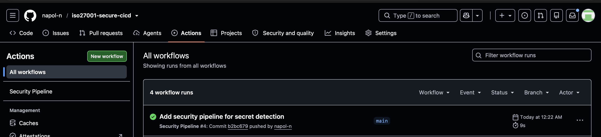
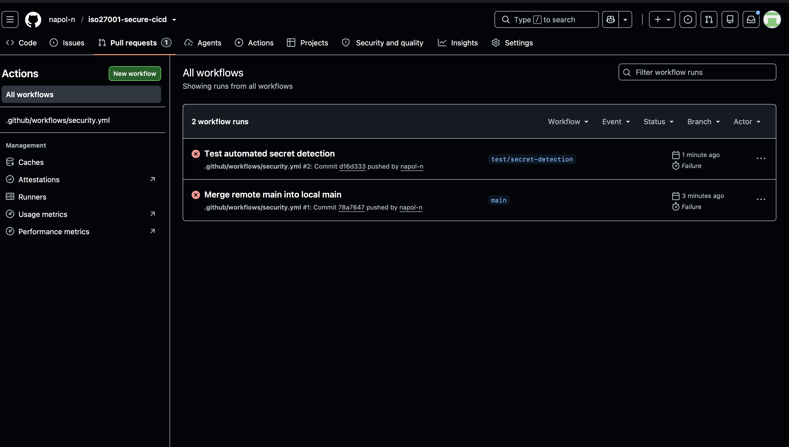

# Security Control Test Results

## Control information

- **CTRL-001:** Automated Secret Detection; **risk:** RISK-001.
- **Implementation:** [security/secret_scan.py](../security/secret_scan.py).
- **Automation:** [Security Pipeline](../.github/workflows/security.yml).
- **Supporting mappings:** A.8.25 Secure development life cycle; A.8.28 Secure
  coding; A.8.29 Security testing in development and acceptance.
- **Execution context and limitations:** [validation report](validation-report.md).

## Historical evidence retained from the original project

### TEST-001 — Clean Source Code

**Objective:** Allow source without detected hardcoded credentials to pass.

**Original procedure:** Run the scanner on clean application code, push to main,
and observe the Security Pipeline. Current changes should instead use a dedicated
branch and PR; the historical main push is not a recommendation to bypass review.

**Expected:** Scanner exit 0 and successful job.

**Observed:** The existing screenshot shows success for commit `b2bc679`.
[Run 32397220447](https://github.com/napol-n/iso27001-secure-cicd/actions/runs/32397220447)
has a successful `Secret Detection` job and `Run secret scanner` step. The retrieved
job log contains the following lines, timestamped 2026-08-20T17:22:20Z:

```text
Security Gate: PASSED
No hardcoded secrets detected.
```



**Conclusion:** Historical clean-path execution corroborated. The job status supports
successful command completion; the excerpt does not separately print a numeric exit
code. It does not demonstrate the revised scanner, SAST, or dependency audit.

### TEST-002 — Historical Failed Workflow

**Objective:** Demonstrate that a simulated secret is rejected.

**Expected:** The scanner detects the synthetic credential, exits 1, and fails a
running CI step.

**Observed:** The existing image shows a failed workflow at commit `d16d333`.
[Run 32396024034](https://github.com/napol-n/iso27001-secure-cicd/actions/runs/32396024034)
is marked `failure`, but the jobs API returned `total_count: 0` at review. No scanner
step or exit code was available to corroborate secret detection. The exact cause of
that historical workflow failure has not been established.



**Conclusion:** Insufficient evidence of a functioning secret-detection gate. Retain
as workflow-failure context only; do not claim TEST-002 passed based on this image.

## Current reproducible control tests

Run `python -m pytest -q --junitxml=reports/pytest.xml` after installing the pinned
tools. Test inputs are synthetic, created under temporary directories, and never
used as credentials. See [test source](../tests/test_secret_scan.py),
[SAST gate tests](../tests/test_security_tools.py), [actual XML](pytest.xml), and
[captured command results](local-validation.json).

| Test group | Expected result | Observed local result |
|---|---|---|
| Clean code, environment lookups, explicit template placeholders, empty literals | No findings; clean CLI exits 0 | Assertions passed |
| Original API key/password/secret/token categories and expanded names | Correct finding category | Assertions passed |
| JSON, YAML, dotenv, TOML, JavaScript, typed Python, extensionless, BOM/CRLF | Configured patterns found | Assertions passed |
| Selected AWS/GitHub token shapes and private-key headers | Category finding | Assertions passed |
| Weak password-like strings | Still flagged; no blanket “test/example” allowlist | Assertions passed |
| Repeated/multiple findings across nested files | Correct occurrences and line numbers; compatibility API returns unique types | Assertions passed |
| Excluded directories and known binary suffixes | Skipped and counted with an eligible file present | Assertions passed |
| Invalid UTF-8/NUL data, oversized files, missing/empty targets | Exit 2, no clean verdict | Assertions passed |
| Symlinks, special files, simulated read/traversal permission errors | Fail closed; no unsafe traversal or raw error payload | Assertions passed |
| Synthetic secret CLI | Exit 1; metadata only; value absent in stdout/stderr | Assertions passed |
| Secret plus unreadable file | Exit 2 takes precedence over exit 1 | Assertions passed |
| Original unchanged app entry point | Clean exits 0; original synthetic secret case exits 1 | Assertions passed |
| Bandit clean and unsafe temporary code | Clean exits 0; unsafe case exits 1 with B307; no source snippet | Assertions passed |

**Observed aggregate:** 65 tests passed locally on Python 3.13.5. The exact execution
time, source hashes, and result streams are in the JSON/XML evidence. Passing negative
tests mean the underlying gates rejected the input as expected; they do not mean
that insecure code was accepted.

## Dependency gate observations

| Case | Expected result | Observed result |
|---|---|---|
| Initial environment with bundled pip 25.1.1 | Any known advisory must fail the audit | Exit 1; tool reported 12 advisory records for pip (including duplicate IDs) |
| After pinning/installing pip 26.2.1 | Clean assessed environment exits 0 | See [audit JSON](dependency-audit.json) and [validation report](validation-report.md) |
| Temporary requirement `urllib3==1.26.5`, audited without installation | Known-vulnerable package exits nonzero | Exit 1; tool reported 18 advisory records (including duplicate IDs) |
| Initial sandbox-restricted network request | Audit error must not be called clean | Exit 1 with DNS error; retried with network access |

The negative dependency probe used `--no-deps --disable-pip` only for a deliberately
isolated requirement. Normal CI uses the full installed environment and `--strict`.
Advisory counts are time-specific tool output, not independently deduplicated CVEs.

## What these results do not prove

No complete secret coverage, Git history cleanliness, prevented initial exposure,
blocked merge, real application exploit resistance, production deployment, independent
review, management approval, or ISO certification is established. Permission tests
use deterministic mocks for reproducibility; they are not an operating-system ACL
audit. See the [control effectiveness assessment](../grc/control-effectiveness.md).
